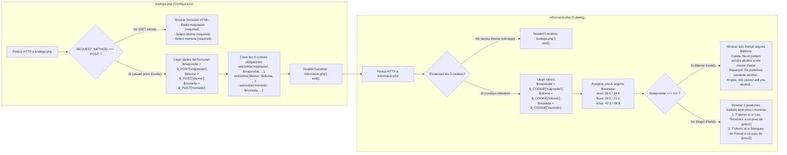

# 🔄 Workflows d'Execució: Exercicis de Cookies en PHP

Aquest document descriu el flux real d'execució pas a pas dels dos exercicis de cookies mitjançant diagrames horitzontals en Mermaid (`flowchart LR`), explicacions senzilles i casos pràctics amb dades reals.

---

# 1. Exercici 1: `comptador_visites.php`

## 1.1 Diagrama Horitzontal d'Execució (Mermaid `flowchart LR`)

```mermaid
flowchart LR
    A["Petició HTTP al fitxer<br/>comptador_visites.php"] --> B{"isset($_COOKIE['contador'])"}
    
    B -- "Si (ja té cookie)" --> C1["$contador = (int)$_COOKIE['contador'] + 1;"]
    B -- "No (primera visita)" --> C2["$contador = 1;"]
    
    C1 --> D["setcookie('contador', $contador,<br/>time() + (3600 * 24 * 30), '/');"]
    C2 --> D
    
    D --> E{"isset($_COOKIE['ha_comprat_descompte'])<br/>&& $_COOKIE['ha_comprat_descompte'] === 'si'"}
    E -- "Si" --> E1["$haCompratAmbDescompte = true;"]
    E -- "No" --> E2["$haCompratAmbDescompte = false;"]
    
    E1 --> F{"$contador >= 10 ?"}
    E2 --> F
    
    F -- ">= 10 i no ha comprat" --> F1["$missatgeOferta = 'Oferta exclusiva sols per a tu! Utilitza el codi BOTIGA50...';"]
    F -- ">= 5 i &lt; 10" --> F2["$missatgeOferta = 'Oferta exclusiva! Utilitza el codi BOTIGA20...';"]
    F -- "Altres visites" --> F3["$missatgeOferta = '';"]
    
    F1 --> G{"POST boto_compra premut?"}
    F2 --> G
    F3 --> G
    
    G -- "Si (enviant codi)" --> H{"Quin codi s'ha introduit?"}
    G -- "No (visita normal GET)" --> I["Render HTML final:<br/>- Mostrar $contador<br/>- Mostrar $missatgeOferta<br/>- Formulari buit de compra"]
    
    H -- "BOTIGA20" --> H1["$missatgeCompra = '20% descompte aplicat';<br/>setcookie('ha_comprat_descompte', 'si', ...);"]
    H -- "BOTIGA50" --> H2["$missatgeCompra = '50% descompte aplicat';<br/>setcookie('ha_comprat_descompte', 'si', ...);"]
    H -- "Altre / buit" --> H3["$missatgeCompra = 'Compra sense descompte';"]
    
    H1 --> I
    H2 --> I
    H3 --> I
```

## 1.2 Com funciona a la vida real? (Explicació en llenguatge normal)

Imagina una botiga física on el caixer et posa un segell en una targeta cada cop que entres per la porta:

### Cas 1: Primera visita de l'usuari
1. L'usuari obre `http://localhost/.../comptador_visites.php`.
2. El servidor PHP pregunta: *«Porta aquest client la cookie `contador`?»*. Com que és el primer cop, la resposta és **No**.
3. El codi assigna `$contador = 1`.
4. El servidor envia una ordre a la capçalera HTTP dient-li al navegador: *«Guarda la cookie `contador = 1` durant 30 dies»*.
5. A la pantalla apareix:
   - `Numero de visites: 1`
   - El formulari de descompte i el botó de comprar.

### Cas 2: Arriba a la visita 5 (Saltar el primer descompte)
1. L'usuari recarrega la pàgina per cinquena vegada.
2. El navegador envia automàticament la cookie `contador=4`.
3. El codi fa `4 + 1 = 5` i actualitza la cookie a `5`.
4. Com que `$contador >= 5`, s'activa la condició d'oferta.
5. A la pantalla apareix:
   - `Numero de visites: 5`
   - **Oferta exclusiva! Utilitza el codi BOTIGA20 per obtenir un 20% de descompte en les teves primeres compres a la botiga**

### Cas 3: Compra a la visita 10 amb descompte
1. A la visita 10, com que l'usuari mai ha comprat amb descompte, apareix l'oferta del **50%** amb `BOTIGA50`.
2. L'usuari escriu `BOTIGA50` a la caixa de text i prem el botó **Comprar**.
3. El codi rep el POST, comprova el text i guarda la cookie `ha_comprat_descompte = "si"`.
4. A la pantalla apareix: `Compra realitzada amb un 50% de descompte aplicat.`.
5. Si l'usuari torna a entrar a la visita 11, el codi veu que ja té `ha_comprat_descompte = "si"` i **ja no li torna a mostrar el cupó del 50%**.

---

# 2. Exercici 2: `bodega.php` i `informacio.php`

## 2.1 Diagrama Horitzontal d'Execució (Mermaid `flowchart LR`)

## 2.2 Com funciona a la vida real? (Explicació en llenguatge normal)

Aquest exercici funciona exactament com el control d'edat i de regió de qualsevol botiga internacional:

### Cas 1: L'usuari configura les preferències
1. L'usuari entra a `bodega.php`.
2. Com que arriba per GET, el codi mostra el formulari amb les 3 preguntes obligatòries (`required` en HTML).
3. L'usuari tria:
   - **Major d'edat:** `Si`
   - **Idioma:** `Catala`
   - **Moneda:** `Euros`
4. Prem **Enviar**.
5. PHP rep el `POST`, crea les 3 cookies (`majoredat`, `idioma`, `moneda`) i redirigeix automàticament a `informacio.php`.

### Cas 2: La pàgina d'informació mostra els productes
1. En arribar a `informacio.php`, el navegador envia les 3 cookies que s'acaben de guardar.
2. El codi comprova:
   - Com que `majoredat` és `"si"`, no mostra cap avís de bloqueig.
   - Com que `idioma` és `"catala"`, prepara els textos en català.
   - Com que `moneda` és `"euro"`, assigna `39 €` i `24 €`.
3. El resultat final que l'usuari llegeix a la pantalla és:
   - `T'oferim el vi "Les Terrasses" a un preu de 39 €`
   - `T'oferim el vi "Marques de Riscal" a un preu de 24 €`

### Cas 3: Què passa si l'usuari indica que és menor d'edat?
1. L'usuari entra a `bodega.php` i selecciona `No` a major d'edat, idioma `Angles` i moneda `Dolars`.
2. `bodega.php` guarda `majoredat=no`, `idioma=angles`, `moneda=dolar`.
3. `informacio.php` llegeix que `majoredat === "no"`.
4. El codi oculta immediatament els productes i només imprimeix l'avís de menor en anglès:
   - `We cannot sell you alcohol if you are a minor.`

---

## 3. El "Truc" Tècnic del Codi

1. **`setcookie()` abans de qualsevol sortida:** Tant a `comptador_visites.php` com a `bodega.php`, `setcookie()` està situat a la primera línia de PHP, abans de `<!DOCTYPE html>`. Si s'imprimís un espai abans, PHP fallaria perquè les cookies viatgen a les capçaleres HTTP.
2. **`header("Location: ...") + exit()`:** En el formulari de la bodega, redirigir a una altra pàgina després de desar les cookies evita que l'usuari reenvïi el formulari accidentalment si prem F5 (patró Post/Redirect/Get).
3. **Persistència de 30 dies:** `time() + (3600 * 24 * 30)` calcula el segon exacte d'aquí a un mes per tal que el navegador recordi les dades encara que l'usuari tanqui el navegador.
